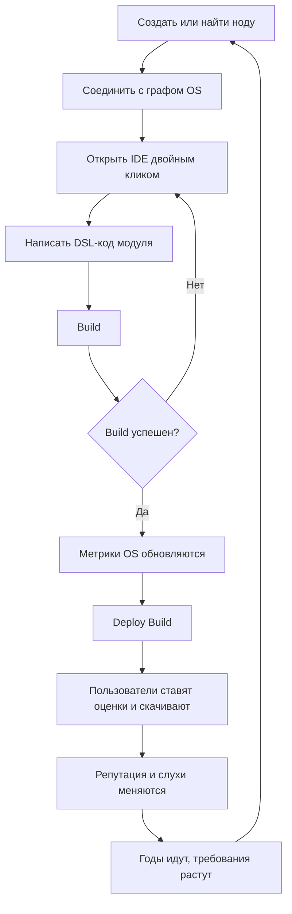
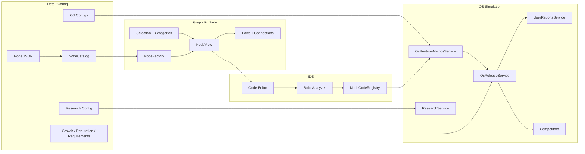
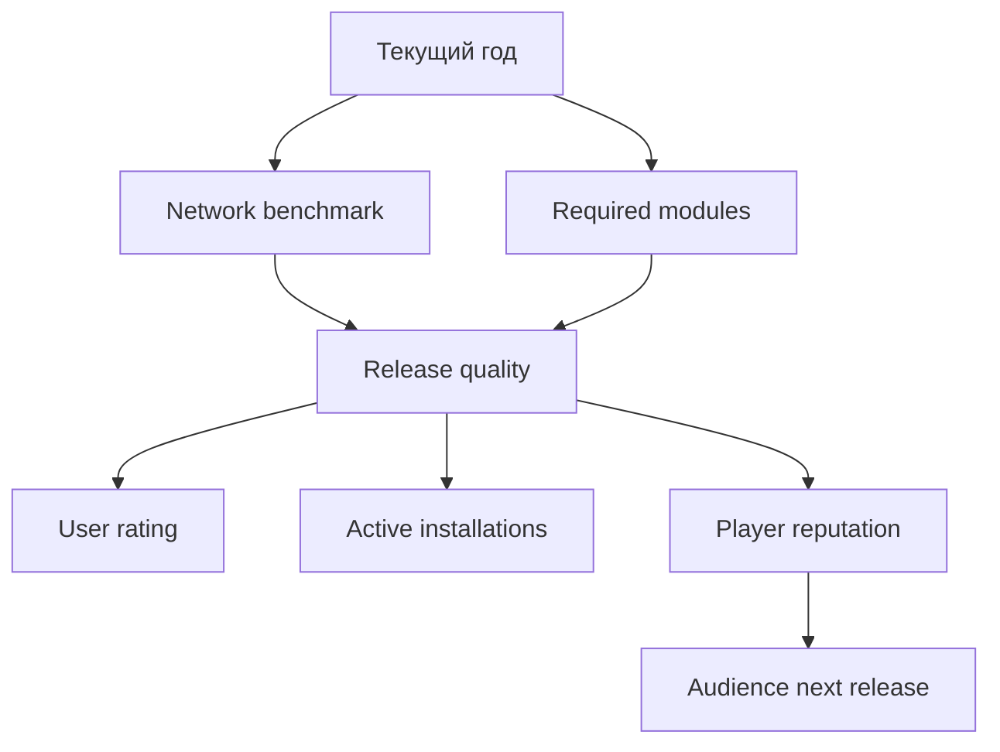

# 🖥️ GraphComputer

> Интерактивная игра про сборку собственной операционной системы из живого графа модулей.

`GraphComputer` смешивает визуальное программирование, системный менеджмент и атмосферу ранней компьютерной эпохи. Игрок строит OS из нод, соединяет модули, открывает встроенную IDE, пишет DSL-код, публикует билды и смотрит, как пользователи, конкуренты и время реагируют на качество архитектуры.

| Статус | Значение |
| --- | --- |
| 🎮 Жанр | System/OS builder, graph sandbox, programming sim |
| 🧭 Старт эпохи | 1995 год |
| 🛠️ Движок | Unity `6000.5.1f1` |
| 🧩 Главная сцена | `Assets/_MyProject/Scenes/Game.unity` |
| 🧠 Главная идея | OS работает только тогда, когда граф, код и runtime-метрики сходятся |
| 📚 Карта проекта | `PROJECT_MAP.md` |
| 💾 DSL | `GRAPH_OS_LANGUAGE.md` |

---

## ✨ Что Уже Есть

| Система | Что делает | Где смотреть |
| --- | --- | --- |
| 🧩 Graph Nodes | Ноды, порты, связи, context menu, spawn по каталогу | `Features/Nodes`, `Common/NodeCatalog` |
| 🧠 IDE + DSL | Встроенная IDE, подсветка, autocomplete, undo/redo, build analyzer | `Features/IDE`, `Features/UserInterface` |
| 🧾 JSON Nodes | Стартовый код `initialCode`, fallback `mode`, stats/ports из JSON | `Common/Data/Nodes` |
| 📦 Build Registry | Хранит код, build status и настройки модулей | `Nodes/CodeRegistry/NodeCodeRegistry.cs` |
| 📊 OS Metrics | Stability, load, memory, storage, network и ветки Kernel/Data/Security/Control | `Features/OS/Runtime` |
| ⏳ Time | Игровая дата, скорость времени, `module Time` и `speed = 60x` | `Features/World/GameTimeService.cs` |
| 🔬 Research | Дерево исследований по вкладкам, стоимость в днях, зависимости, mutual exclusion и unlock нод | `Common/Research`, `Features/Research`, `Features/UserInterface/Research` |
| 🌐 Era Aging | Сеть и требования пользователей стареют по годам | `Common/OS`, `Common/Data/OS` |
| 🧲 Selection | Клик, select box, delete выбранных нод | `Features/Selection` |
| 🗂️ Categories | Рамки категорий вокруг выбранных нод | `Features/Selection/Categories` |
| 🚦 CircleStatus | Цветной статус ноды: healthy/limit/error | `Nodes/Presentation/Core` |
| 🪟 OS Window | Tab-based окно OS info, health, release, competitors | `Features/UserInterface/OS` |
| 🧯 Input Guard | IDE/OS/Research и вложенные CanvasGroup не дают gameplay input протекать сквозь UI | `Features/Input`, `Features/UserInterface` |
| 🚀 Release | Deploy build, active installations, rating, update status | `Features/OS/Release` |
| 📣 Reputation | Доверие к игроку влияет на следующие релизы | `Features/OS/Reputation`, `Common/OS/Reputation` |
| 🏢 Competitors | Конкуренты растут по конфигу, игрок участвует в рейтинге | `Features/OS/Competitors`, `Common/OS/Competitors` |
| 🗣️ User Reports | Пользователи жалуются/хвалят OS по runtime-состоянию | `Features/World/Reports` |
| 🔔 Notifications | Popup-уведомления с fade root, scale content, статусом и двумя optional `ButtonManager` action-кнопками | `Features/UserInterface/Notifications` |
| 🎨 Shader Pack | Необязательные материалы для research, нод, связей, firewall, memory glitch, terminal glass и world data rain | `Art/_Shaders`, `Art/Materials` |
| 🔤 Runtime Text Refresh | Общий безопасный путь для программного обновления TMP/legacy text/ButtonManager | `Features/UserInterface/RuntimeTextRefresh.cs` |

---

## 🎮 Игровой Цикл



Ключевая петля простая: **граф → код → build → runtime metrics → публикация → пользователи → новые требования**.

---

## 🧱 Архитектура В Общем Виде



---

## 🧠 Внутренний DSL

DSL не является языком общего назначения. Это декларативный язык OS-модулей: зависимости, бюджет, режим, runtime-намерения и экспортируемые метрики.

```text
module SystemCore

mode = balanced
platform = PC

require Kernel as kernel
require Data as data
optional Security as security

budget {
    cpu <= 72
    memory <= 68
    storage <= 80
}

boot {
    start kernel.scheduler
    mount data.fileSystem
    scan security.firewall
}

export {
    stability = 100 - kernel.load * 0.25
    load = kernel.load
}
```

| Команда | Назначение |
| --- | --- |
| `module` | Имя модуля. Без него build падает. |
| `mode` | Режим работы: `balanced`, `strict`, `permissive`, `aggressive`, `safe`, `performance`. |
| `platform` | Платформа релиза OS. Сейчас `PC` попадает в Supported Devices. |
| `require` | Обязательная зависимость. |
| `optional` | Мягкая зависимость. |
| `budget` | CPU/memory/storage ограничения. |
| `boot`, `tick`, `export` | Сигналы намерений и runtime-эффектов. |

Полная спецификация лежит в `GRAPH_OS_LANGUAGE.md`.

---

## ⌨️ IDE, Окна И Input Guard

IDE живёт как отдельный UI runtime поверх графа. Открытие документа идёт через `IdeOpenNodeOnDoubleClick` и `IdeRuntimeController`, а активные документы держит `IdeCodeTabsController`.

| Действие | Как работает |
| --- | --- |
| Двойной клик по ноде | Открывает IDE и документ этой ноды |
| `Tab` в редакторе | Вставляет отступ, не переключает фокус |
| `Ctrl+Z` | Undo последнего изменения кода |
| `Ctrl+Y` / `Ctrl+Shift+Z` | Redo отката |
| `Escape` | Закрывает IDE, если включён `closeWithEscape` |
| `Shift+Tab` | Переключает отдельный `CanvasGroup`, например console/output, только если родительские группы видимы |
| `Tab` для OS window | Открывает/закрывает OS-окно, но блокируется, если видима IDE или другая указанная CanvasGroup |
| Space / Input Action для Research | Открывает/закрывает Research window через `InputActionReference` |

Главные защитные компоненты:

- `IdeGameplayInputBlocker` ставит глобальный `GameInputBlocker`, когда IDE root CanvasGroup видим.
- `OsWindowController.blockInputWhenGroupsVisible` не даёт OS открываться поверх IDE/других активных UI.
- `IdeWindowCanvasGroupController.hideOnCloseGroups` принудительно скрывает вложенные панели IDE при закрытии окна, чтобы они не продолжали держать input.
- `CanvasGroupShiftTabToggle.requireVisibleParentGroups` не открывает дочернюю панель, если родительское окно уже скрыто.

---

## 🧩 Ноды И Их Роли

| Нода | Роль | Цена ошибки |
| --- | --- | --- |
| `System Core` | Корень OS и главный агрегатор метрик | Без него OS не становится полноценной системой |
| `Kernel` | Процессы, планирование, crash risk, response time | Высокий риск зависаний и падений |
| `Data` | Хранилище, чтение, data safety, index size | Потеря данных, фрагментация, медленный IO |
| `Security` | Угрозы, firewall, шифрование, false blocks | Уязвимости или агрессивные блокировки |
| `Control` | Devices, input, sound, power | Плохая совместимость и UX |
| `Firewall` | Усиление защиты | False blocks, нагрузка на сеть |
| `File System` | Read/write и безопасность данных | Storage usage, fragmentation |
| `Memory Manager` | RAM, лимит процессов, response time | Leak risk, crash risk |
| `Display Manager` | UI/устройства/удобство | GPU usage и memory pressure |
| `Time` | Дата, часы и скорость времени | Неверная скорость симуляции |
| `News` | Новости эпохи | Контекст мира теряется |
| `User Reports` | Реакция пользователей | Непонятно, почему OS любят или ругают |

---

## 📊 OS Metrics

| Метрика | Что означает | Откуда берётся |
| --- | --- | --- |
| System Stability | Общая надёжность OS | Core + Kernel + Security + штрафы |
| Network Speed | Сетевая скорость в контексте года | OS config + era evaluator |
| System Load | Общая нагрузка | Ноды, режимы, побочные эффекты |
| Memory Usage | Давление на RAM | Kernel, Memory Manager, Display |
| Storage Usage | Давление на диск | Data, File System, фрагментация |
| Security Score | Безопасность | Security, Firewall, encryption |
| Compatibility | Поддержка устройств | Control и дочерние модули |
| Code Quality | Качество сборки | Build success, режимы, debt |

### Цвета статусов

| Цвет | Значение |
| --- | --- |
| 🟢 Green | Работает нормально |
| 🟠 Orange | На пределе или терпимо |
| 🔴 Red | Ошибка, offline или критичный риск |

`CircleStatus` на нодах использует те же идеи: зелёный, оранжевый, красный.

---

## 🌐 Механика Устаревания

В игре важна не абсолютная цифра, а **цифра в контексте года**.

Например, `0.44Mbps` в 1995 может быть отличной скоростью. Позже пользователи уже ждут большего, поэтому старая сеть начинает портить стабильность, нагрузку, отзывы и восприятие OS.

| Механика | Где настраивается | Что меняет |
| --- | --- | --- |
| Network era benchmarks | `OsRuntimeMetricsConfig.asset` | Как скорость сети оценивается по годам |
| Required modules by year | `OsModuleRequirementProfile.asset` | Какие модули должны быть в OS к конкретному году |
| Release growth | `OsReleaseGrowthProfile.asset` | Как качество превращается в downloads/rating |
| Player reputation | `OsPlayerReputationProfile.asset` | Как хорошие/плохие релизы влияют на доверие |



---

## 🚀 Release, Репутация И Слухи

Публикация OS идёт через `Deploy Build`.

До публикации:

| Поле | Значение |
| --- | --- |
| Supported Devices | `None` |
| Active Installations | `0` |
| User Rating | `0.0 / 5` |
| Latest Release | `None` |
| Update Status | `Not Published` |

После публикации:

1. `SystemCore` должен быть успешно собран.
2. В DSL должен быть `platform = PC`, чтобы появилось `Supported Devices: PC`.
3. Релиз начинает набирать installations.
4. Качество OS влияет на rating.
5. Хорошие релизы усиливают word of mouth.
6. Плохие релизы портят доверие к будущим релизам.

### Рост аудитории


---

## 🏢 Конкуренты

Конкуренты растут сами по `OsCompetitorConfig.asset`. Игрок теперь тоже добавляется в список, чтобы было видно место GraphOS на рынке.

| Компания | OS | Старт |
| --- | --- | --- |
| Macrosoft | WindowBox 95 | 450,000 users |
| Pear Systems | ClassicOS 7 | 90,000 users |
| NovaWare | DeskOS | 25,000 users |
| You | GraphOS | Берётся из Active Installations |

Список сортируется по users:

```text
1. Macrosoft      WindowBox 95 | 450,000 users
2. Pear Systems   ClassicOS 7  | 90,000 users
3. NovaWare       DeskOS       | 25,000 users
4. You            GraphOS      | 0 users
```

Если GraphOS обгоняет Macrosoft, игрок автоматически становится первым.

---

## 🔬 Research

Research - отдельная прогрессия поверх игрового времени. Исследования задаются в `ResearchConfig.asset`, группируются по `tabId`, стоят несколько игровых дней и могут открывать ноды через `unlockedNodeDefinitionIds`.

| Часть | Что делает |
| --- | --- |
| `ResearchConfig` | Хранит список исследований и умеет искать definition по id |
| `ResearchDefinition` | Id, вкладка, title, description, cost days, grid position, prerequisites, mutual exclusions, unlock node ids |
| `ResearchService` | Запускает research, отслеживает прогресс по `GameTimeService`, завершает по дням, блокирует locked/excluded/in-progress states |
| `ResearchTreePresenter` | Строит кнопки и линии дерева для текущей вкладки |
| `ResearchTabsController` | Переключает вкладки research и синхронизирует дерево |
| `ResearchWindowController` | Открывает/закрывает окно кнопками или `InputActionReference`, поддерживает scale/fade animation |
| `ResearchTooltipView` | Показывает описание, стоимость, prerequisites и mutual exclusions |

Состояния:

| Status | Значение |
| --- | --- |
| `Locked` | Не выполнены prerequisite |
| `Available` | Можно начать |
| `InProgress` | Идёт исследование, показываются оставшиеся дни |
| `Completed` | Завершено |
| `Excluded` | Заблокировано из-за mutual exclusion |

UI дерева не генерирует весь экран сам. В сцене назначаются roots, scroll content, template кнопки, line template и tooltip, а код только клонирует элементы и заполняет состояние.

---

## 🧲 Selection И Categories

| Действие | Как работает |
| --- | --- |
| Клик по ноде | Выделяет одну ноду |
| Shift/Ctrl | Добавление или toggle выбора |
| Select box | Рамка выделяет несколько нод даже при разных Canvas |
| Delete/Backspace | Удаляет выбранные ноды и связанные линии |
| ПКМ по выделению | Context menu может создать категорию |
| Category frame | Prefab-рамка вокруг выбранных нод |

UI и prefab не создаются кодом автоматически. Код ожидает, что нужные `RectTransform`, prefab, `Image`, `CanvasGroup` и templates будут назначены в сцене вручную.

---

## 🔔 Notifications

Notification UI сделан как view-слой без автосоздания prefab. Ты собираешь визуал в сцене сам, а код только заполняет уже назначенные поля.

| Поле в `NotificationView` | Что назначить |
| --- | --- |
| `Notification Group` | Root `CanvasGroup` всего затемнения/уведомления |
| `Content Root` | Внутренний `RectTransform` карточки уведомления |
| `Title Text` | `TMP_Text` заголовка |
| `Body Text` | `TMP_Text` тела |
| `Status Circle` | `Image` кружка статуса |
| `Primary Button` / `Secondary Button` | Две кнопки Modern UI Pack `ButtonManager` |

Если в `NotificationEvent` action не указан или label пустой, соответствующая кнопка заранее выключается. Root открывается через fade, а `Content Root` получает popup scale-анимацию через PrimeTween.

```csharp
notificationView.Show(new NotificationEvent(
    "Kernel Panic",
    "Memory management failure is consuming system resources.",
    NotificationStatus.Error,
    new NotificationAction("Apply Hotfix"),
    new NotificationAction("Restart Module")
));
```

---

## 🎨 Шейдеры И Материалы

Шейдеры необязательные: игра не должна зависеть от них логически. Их можно назначать на материалы UI/нод/линий для усиления визуала, а если материал не назначен, системы должны продолжать работать обычной графикой.

| Шейдер | Материал | Что делает |
| --- | --- | --- |
| `ResearchProgressCompiler.shader` | `M_ResearchProgressCompiler.mat` | Пульсирующий research-progress эффект: подходит для кнопки/панели исследования в процессе |
| `NodeSignalBloom.shader` | `M_NodeSignalBloom.mat` | Мягкое свечение активной ноды или важного модуля |
| `PacketTraceFlow.shader` | `M_PacketTraceFlow.mat` | Поток пакетов/данных по линии или панели network/data |
| `FirewallPulseBarrier.shader` | `M_FirewallPulseBarrier.mat` | Импульсный защитный барьер для security/firewall UI |
| `MemoryCorruptionGlitch.shader` | `M_MemoryCorruptionGlitch.mat` | Глитч/битые полосы для ошибок памяти, crash risk и bad states |
| `TerminalGlass.shader` | `M_TerminalGlass.mat` | Полупрозрачное terminal glass покрытие для IDE/console |
| `WorldDataRain.shader` | `M_WorldDataRain.mat` | Фоновый data-rain для мира/OS-информации |
| `LinkOverdrive.shader` | `M_LinkOverdrive.mat` | Перегруженный сигнал для активных/проблемных connections |
| `NeuralCircuitAura.shader` | `M_NeuralCircuitAura.mat` | Аура circuit/AI-like активности вокруг сложных модулей |
| `NodeHeatMapOverlay.shader` | `M_NodeHeatMapOverlay.mat` | Overlay нагрузки/тепловой карты для high load nodes |
| `GraphComputerGridBackground.shader` | `M_GridBackground.mat` | Живой фон сетки графа |
| `GraphComputerPanoramaBackground.shader` | `M_PanoramaBackground.mat` | Панорамный фон сцены |
| `GraphComputerNodePanelBackground.shader` | `M_NodePanelBackground.mat` | Материал панели ноды |
| `GraphComputerNodeHeader.shader` | `M_NodeHeader.mat` | Материал header ноды |
| `NodeConnectionFlow.shader` | `M_NodeConnectionFlow.mat` | Базовое течение сигнала по connection line |

---

## 🔤 Runtime Text Refresh

В проекте есть единый helper `RuntimeTextRefresh`: через него лучше менять текст из кода, если это `TMP_Text`, legacy `Text`, `TMP_InputField` или Modern UI Pack `ButtonManager`.

Зачем он нужен: TMP иногда не перестраивает меш сразу после программного `text = ...`, из-за чего текст выглядит битым до клика/фокуса. Helper ставит текст, dirty-флаги, `ForceMeshUpdate` и layout rebuild. Новые UI-скрипты должны использовать его вместо прямого `.text = ...`.

---

## 🗂️ Важные Конфиги

| Что менять | Файл |
| --- | --- |
| Каталог нод | `Assets/_MyProject/_Scripts/Common/NodeCatalog/NodeCatalog.asset` |
| JSON-описания нод | `Assets/_MyProject/_Scripts/Common/Data/Nodes` |
| OS metrics balance | `Assets/_MyProject/_Scripts/Common/Data/OS/OsRuntimeMetricsConfig.asset` |
| Release growth | `Assets/_MyProject/_Scripts/Common/Data/OS/OsReleaseGrowthProfile.asset` |
| Reputation balance | `Assets/_MyProject/_Scripts/Common/Data/OS/OsPlayerReputationProfile.asset` |
| Module requirements by year | `Assets/_MyProject/_Scripts/Common/Data/OS/OsModuleRequirementProfile.asset` |
| Competitors | `Assets/_MyProject/_Scripts/Common/Data/OS/OsCompetitorConfig.asset` |
| Research tree | `Assets/_MyProject/_Scripts/Common/Data/Research/ResearchConfig.asset` |
| Era news | `Assets/_MyProject/_Scripts/Common/Data/Nodes/Era News/EraNewsDatabase/EraNewsDatabase.asset` |

---

## 🧭 Структура Проекта

```text
Assets/_MyProject
├─ Art          # shaders, materials, TMP font assets
├─ Prefab       # node/UI prefabs
├─ Scenes       # Game.unity
├─ Settings     # URP, input, volume, scene templates
├─ Sounds       # music/audio
└─ _Scripts     # C# source
```

Ключевые зоны кода:

| Папка | Назначение |
| --- | --- |
| `Features/Nodes` | Ноды, порты, линии, runtime behaviours |
| `Features/IDE` | Редактор кода, build analyzer, module settings |
| `Features/OS` | OS metrics, release, reputation, competitors |
| `Features/Research` | Runtime-сервис исследований |
| `Features/Selection` | Select box, selected nodes, categories |
| `Features/Input` | Глобальная блокировка gameplay/camera input под UI |
| `Features/UserInterface` | IDE UI, OS window, research window, panels, tabs, notifications, text refresh |
| `Features/World` | Time, news, user reports |
| `Features/Grid` | Grid domain/presentation/composition |
| `Common/OS` | Чистые модели и ScriptableObject configs |
| `Common/Research` | Чистые модели и ScriptableObject config исследований |

---

## 🛠️ Правила Разработки

| Правило | Почему важно |
| --- | --- |
| Не больше 7 `.cs` файлов в одной папке | Папки остаются читаемыми |
| SRP | Каждый класс делает одну понятную работу |
| UI/Prefab вручную | Код не ломает сцену и не генерирует неожиданный UI |
| Config через ScriptableObject | Баланс меняется без переписывания логики |
| Runtime отдельно от View | Логику проще тестировать и расширять |
| `PROJECT_MAP.md` держать свежим | Быстрее понимать, куда идти за изменениями |

---

## 📚 Быстрые Ссылки

| Документ | Для чего |
| --- | --- |
| `PROJECT_MAP.md` | Подробная карта проекта |
| `GRAPH_OS_LANGUAGE.md` | Спецификация DSL |
| `README.md` | Быстрый обзор проекта |

---

## 🧪 Текущий Статус

Проект находится в активной разработке. Уже есть рабочая основа: граф нод, IDE, build analyzer, undo/redo редактора, runtime metrics, время, новости, user reports, релизы, репутация, конкуренты, research tree, select box, категории, notification view, shader pack, input guards и годовое устаревание.

Следующие естественные направления:

- расширять набор нод;
- добавлять новые годы и требования модулей;
- укреплять DSL;
- делать больше сценариев user reports;
- развивать OS market и конкурентов;
- балансировать research tree и привязывать unlock-и к новым нодам;
- полировать UX подключения UI/prefab в сцене.

---

## 🧾 Для Моддеров

Моды разрешены.

Разрешается:

- создавать новые ноды, правила, контент, сценарии, UI-расширения и игровые системы как моды;
- распространять бесплатные или платные моды, если они являются самостоятельной модификацией;
- публиковать патчи, плагины, конфигурации, JSON-описания и ассеты мода;
- указывать совместимость с `GraphComputer`.

Запрещается без отдельного письменного разрешения правообладателя:

- продавать или распространять оригинальную игру как свой продукт;
- распространять изменённую сборку оригинальной игры вместо мода;
- публиковать исходный код оригинальной игры целиком или существенными частями;
- использовать название `GraphComputer` так, будто мод является официальным релизом;
- включать вредоносный код, скрытый сбор данных или обход платёжных/защитных механизмов;
- удалять или скрывать уведомления об авторских правах.

Авторы модов сохраняют права на свой оригинальный вклад: новый код, тексты, графику, музыку, уровни, данные и другие материалы, созданные ими.

---

## ⚖️ Правовой Статус

Copyright (c) 2026 kxyr0. All rights reserved.

`GraphComputer`, исходный код проекта, игровые системы, собственные ассеты, тексты, дизайн нод, структура модулей, внутриигровая IDE, DSL-логика и связанные материалы принадлежат правообладателю проекта, если явно не указано иное.

Этот репозиторий не является open source проектом. Отсутствие отдельной open source лицензии означает, что права не передаются автоматически.

Сторонние ассеты и пакеты остаются под условиями их собственных лицензий. Это касается Unity, TextMesh Pro, PrimeTween, Modern UI Pack и Unity UI Rounded Corners.
